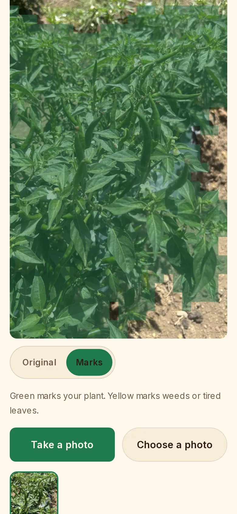
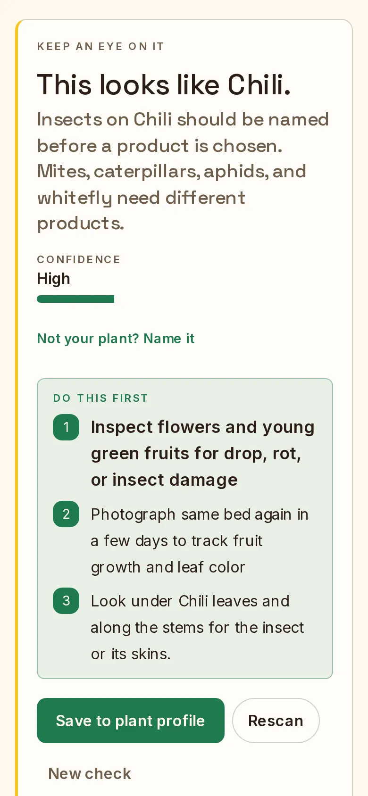
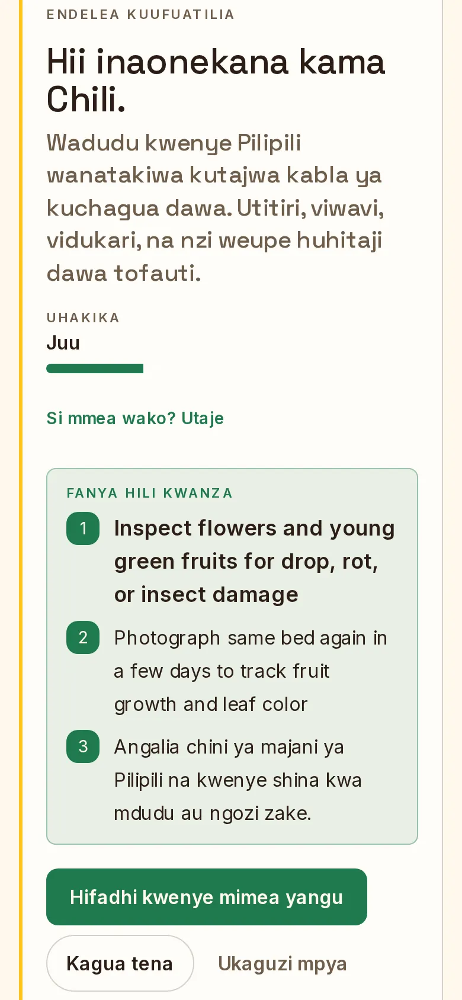
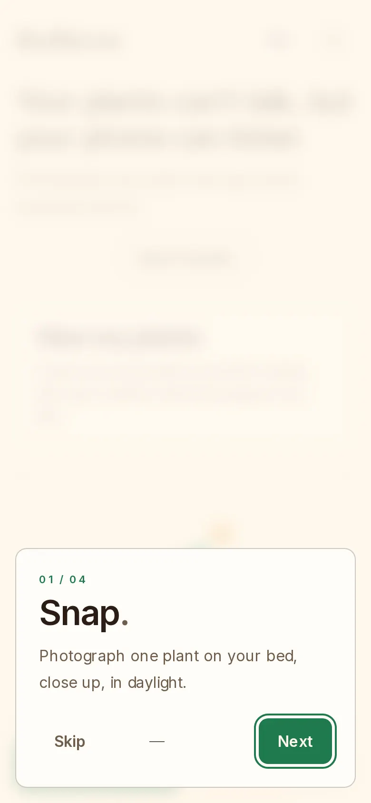
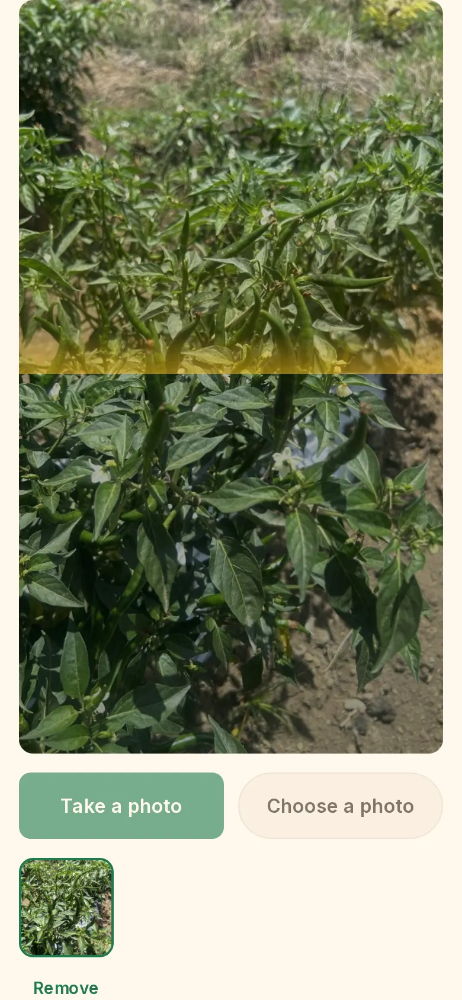
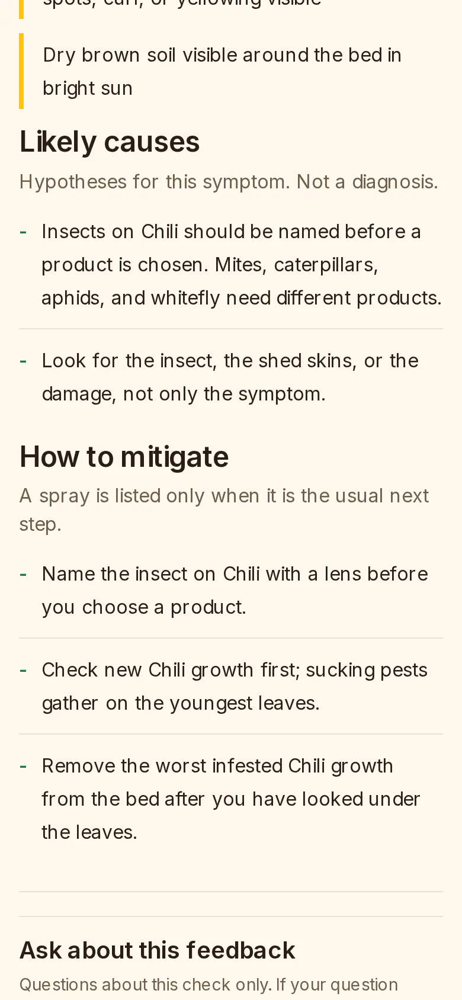
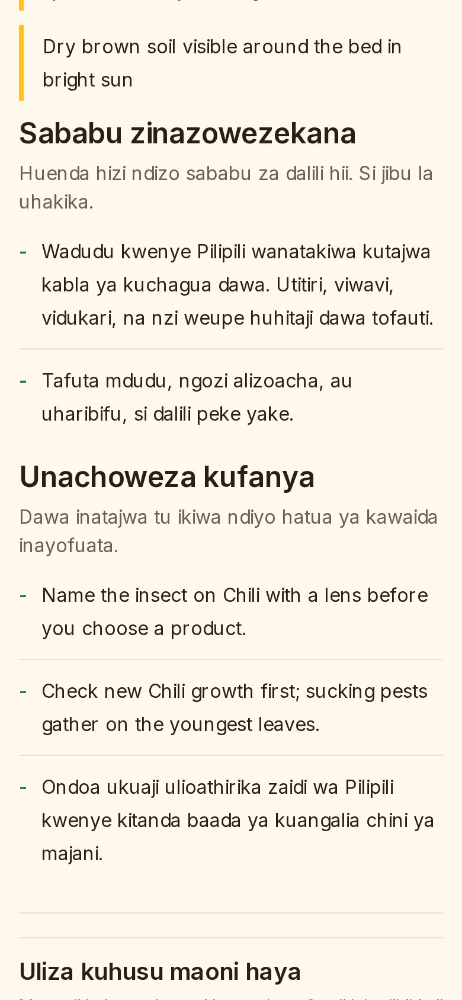
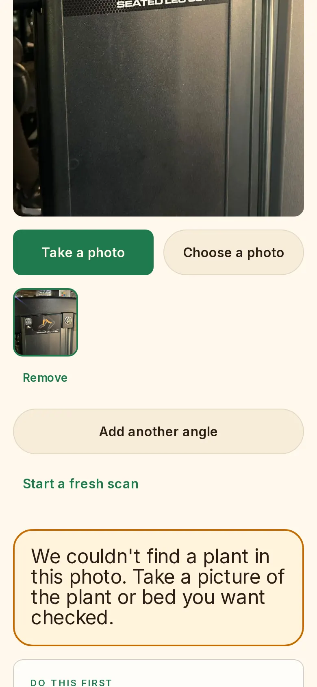
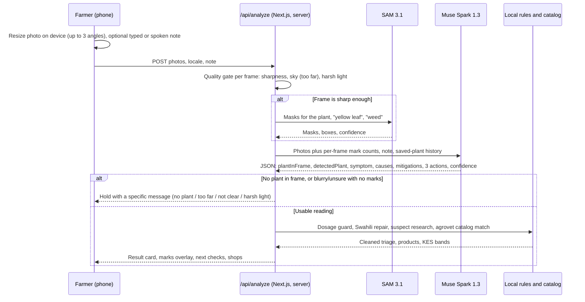
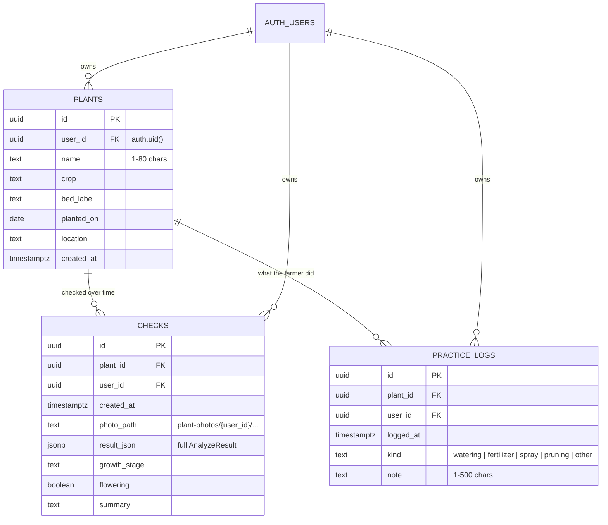

# BedSense

Photograph a plant on a farm bed and get practical, plain-language triage in English or Kiswahili, built on Meta's SAM 3.1 and Muse models.

**Live demo:** https://bedsense.vercel.app · Built for the Meta Global AI Developer Hackathon, Indie track, "Build for Your World".

<p>
  
  
  
  
</p>

## The problem

Smallholder vegetable farmers in Kenya usually find a problem by walking the bed: curled chili fruit, yellow lower leaves, spots after rain. The nearest agronomist or extension officer may be days away. The common fallback is to ask at the agrovet counter, which often ends in a spray being bought before anyone has named the cause. Most advice apps are English-only and assume a clean, close-up leaf photo.

BedSense takes the photo a farmer actually has: a whole bed, hard sun, a hand in the frame. From it, BedSense returns:

- likely causes, as hypotheses rather than a diagnosis
- steps the farmer can start today
- three concrete next checks for that plant
- example Kenyan agrovet products with KES price bands, but only when a spray or fertilizer is the usual next step

The whole screen can be read in Kiswahili.

## Screenshots

| Onboarding | Checking | Result (EN) | Result (SW) |
| --- | --- | --- | --- |
|  |  |  |  |

| Photo with no plant in it | Desktop |
| --- | --- |
|  |  |

The full desktop result page is in [docs/screenshots/desktop-result.webp](docs/screenshots/desktop-result.webp). All screenshots were taken from the live deployment with headless Chromium on 3 Nov 2026, using the real bed photos in `fixtures/chili/` and the gym photo in `fixtures/non-plant/`. The live site returned the no-plant message for the gym photo during that run. The screenshot shown is a re-render of the same screen, fed the server's own response with Muse stubbed, because the deploy's Muse access was unavailable when it was re-shot.

## How it works



The steps in more detail:

1. **Photo on the device.** The phone resizes each photo before upload. A check can hold up to three angles of the same plant. A note is optional. The farmer can type it or dictate it with `muse-voice-transcribe-1.0`.
2. **Quality gates** (`lib/photo-quality.ts`). Each frame is scored for sharpness, wide sky, crushed contrast and deep shadow or blown highlights.
   - A soft frame skips SAM.
   - A frame with no strong mark is held, with a message that says why.
   - When a frame is held as blurry, Muse is still asked whether a plant is in the photo. A gym machine or a wall gets "We couldn't find a plant in this photo" instead of "hold the phone steady".
3. **SAM 3.1** (`lib/server/sam.ts`) segments the plant, yellow leaves and weeds. The masks are drawn over the photo so the farmer can see what was read.
4. **Muse Spark** (`lib/server/muse.ts`) receives every photo, the mark counts for each frame, the note, and (for a saved plant) its earlier checks. It returns strict JSON. The model is chosen from the live `GET /v1/models` catalog: `muse-spark-1.3-contributor` first, then `muse-spark-1.3`, with Muse Wonder accepted as a chat model.
5. **Server-side rules** run on what Muse returns before anything reaches the screen:
   - Numeric spray or mixing rates are removed (`lib/triage.ts`).
   - English drift in a Kiswahili reading is repaired from a local glossary (`lib/translate.ts`).
   - A named suspect is matched to chemicals, fertilizers and cultural practices (`lib/research.ts`).
   - Products are listed only when a spray or fertilizer is the usual next step, and they come from a curated Kenyan agrovet catalog with economy, mid and premium KES bands (`lib/agrovet-catalog.ts`).
6. **Follow-up.** Under every result, `POST /api/ask` answers questions about that result without running a new check. It uses the same dosage guard.

## Meta models used

| Model | Used for | Why |
| --- | --- | --- |
| `sam-3.1` | Plant, yellow-leaf and weed masks | Shows the farmer what was read, and gives Muse counts it can weigh. A wide or blurry frame with no strong mark is held instead of guessed. |
| `muse-spark-1.3-contributor` / `muse-spark-1.3` | Triage JSON and follow-up Q&A | Reads several photos and context in one call, and returns structured output in English or Kiswahili. |
| Muse Wonder (`muse-wonder-*`) | Accepted chat fallback when listed in the catalog | Keeps checks running on keys without Spark. |
| `muse-voice-transcribe-1.0` | Push-to-talk notes | Farmers describe what they did more easily than they type it. Kiswahili sends `["Swahili","English"]` as the language bias and falls back to English only. |
| `muse-image-1.0` | A labeled "what to look for" reference illustration for the named suspect | Shows what a symptom looks like. It is labeled as an illustration, not the farmer's plant. |
| `meta-models/muse-spark-open-1026` | Open-weights fallback for follow-up Q&A through Baseten | Answers still arrive if the Model API fails. |

All calls go through `https://api.meta.ai/v1` (Baseten for the open-weights fallback) from the server. The key never reaches the browser.

## Features

- Photo-only checks. Muse names the plant from the photo. A wrong name can be corrected on the result, which re-runs the check.
- Up to three angles per check, with SAM marks per frame.
- Quality holds with specific messages: too far, not clear, harsh light, mixed, and no plant in the photo.
- Likely causes, mitigations and exactly three next checks. An uncertain reading names no chemical and asks for the missing angle or fact.
- Example Kenyan agrovet shops and KES price bands. These are curated demo ranges, not live quotes.
- Voice notes in English or Kiswahili.
- An EN/SW toggle that re-renders a shown result without re-running it. All labels, hold messages, "Before you act", agrovet notes and the built-in fallback wording switch. Free-form text Muse wrote about a specific photo stays in the language the check was run in.
- Recent checks: the last five stay on the phone, in `localStorage`.
- Saved plants (with sign-in): a timeline of checks, a log of watering, feeding and spraying, progress since the last visit, and a watcher that raises worsening or overdue plants.
- A share card at `/share`.

## Data model

BedSense uses a database for signed-in users only. It is the Supabase project **BedSense**: Postgres 17, plus Auth with phone (SMS OTP) or email sign-in, plus Storage. The schema is in [`supabase/migrations/20261029000000_plant_memory.sql`](supabase/migrations/20261029000000_plant_memory.sql). The live project has the same three tables, each with Row-Level Security on, and one applied migration, `plant_memory`.



- **Row-Level Security.** A user can read and write only rows where `user_id = auth.uid()`. Checks and practice logs must also point at one of that user's own plants.
- **Photos** go to the private Storage bucket `plant-photos`, under a folder named for the user id.
- **`result_json`** stores the whole `AnalyzeResult` (`lib/types.ts`): marks, counts, causes, mitigations, actions, chemicals, the quality hold, progress and the Q&A thread. Old checks re-render without calling a model again.
- **Signed-out use** needs no database. The last five results and the language choice are kept in the browser's `localStorage` (`lib/phone-store.ts`). Without `SUPABASE_URL` and `SUPABASE_ANON_KEY`, the app runs in this mode only.

## Kiswahili

Kiswahili is a full language of the app, not a machine pass over the English:

- UI copy is hand-written with farmers' wording in mind. For example, the voice button reads "Bonyeza kuongea", not a word-for-word "Gonga uongee".
- Muse is prompted to answer in Kiswahili.
- `lib/translate.ts` repairs English words that drift into a Kiswahili reading.
- Plant names fold to local names (Chili / Pilipili).
- A test (`tests/swahili-repair.test.ts`) checks that shipped Kiswahili does not read as English.

## Tech stack

- Next.js 16 (App Router), React 19 and Tailwind CSS v4, deployed on Vercel (Hobby, 60 s function limit).
- Meta Model API (`api.meta.ai/v1`) and `@meta-sam/parser` for SAM mask streams.
- Supabase for Auth, Postgres and Storage (`@supabase/ssr`).
- `jpeg-js` for on-server sharpness and lighting metrics.
- Vitest, ESLint and `tsc`, run in GitHub Actions CI.

## Run it locally

Requires Node.js 20.17 or newer.

```bash
npm install
cp .env.example .env.local
npm run dev        # http://localhost:3000
```

`.env.local`:

```bash
MOCK_META=1          # demo mode: synthetic masks and advice, no Meta calls
MODEL_API_KEY=       # set a Meta Model API key and MOCK_META=0 for live checks
SUPABASE_URL=        # optional: saved plants and sign-in
SUPABASE_ANON_KEY=
```

- With `MOCK_META=1`, or with no key, a fresh clone runs the full UI with no external calls.
- Live mode needs `MOCK_META=0` and a `MODEL_API_KEY`.

The full environment reference and pipeline notes are in [docs/development.md](docs/development.md).

## Tests

```bash
npm test           # vitest
npm run lint
npx tsc --noEmit
```

On 3 Nov 2026, `main` passed all 263 tests. The suite runs with no keys and no Supabase. It covers:

- the quality gates, including the gym non-plant fixture and a blur lab on real chili photos
- the dosage guard
- Muse reply parsing (truncated, prose and empty no-plant replies)
- the agrovet matching
- Swahili repair
- relocalizing a result between EN and SW
- plant memory

## Measured results

These are the only live figures in this repo. They come from production on 28 Oct 2026, using six real, messy chili bed photos in `fixtures/chili/` ([docs/messy-chili-live.md](docs/messy-chili-live.md)):

- **SAM** marked the chili crop on 5 of 6 photos. The miss was the distant bed.
- **Muse** returned a real diagnosis with causes on 6 of 6 photos, with no fallback.

`docs/messy-chili-summary.md` is a scripted logger test, not a field measurement. The offline blur gate is measured in `docs/blur-gate-offline.md` and `docs/blur-lab-live.md`.

## Limitations

- BedSense does triage, not diagnosis. It never gives a spray rate. The label and a local agroveterinary officer decide.
- Agrovet shops and KES bands are a curated demo catalog. There is no live price feed: `liveKenyaShopOffers` is a stub.
- Free-form Muse prose does not switch language after the check. Fixed copy does.
- Meta's voice model does not list Swahili, so Kiswahili dictation can come back partly in English. The farmer can edit the text.
- Live checks depend on the key's Muse access. If the catalog lists no Muse Spark or Wonder model, the check stops with a clear "not available for this key" message instead of guessing.
- Field validation so far is one farm's chili beds.

## Roadmap

- Validate on more crops and farms with extension officers, and publish the per-crop hit rate.
- A live agrovet price and stock source in place of the demo bands.
- Offline queueing for poor signal, sending when back online.
- Kiswahili speech once Meta's transcription supports it.

## License

MIT. See [LICENSE](LICENSE). Contributor setup: [docs/development.md](docs/development.md) and [CONTRIBUTING.md](CONTRIBUTING.md).
