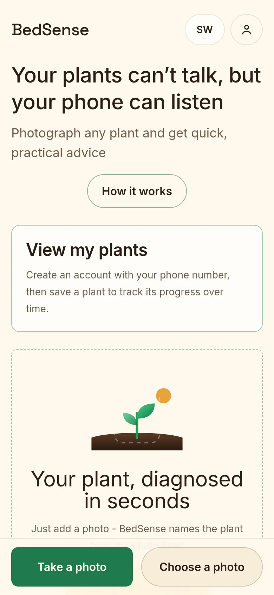
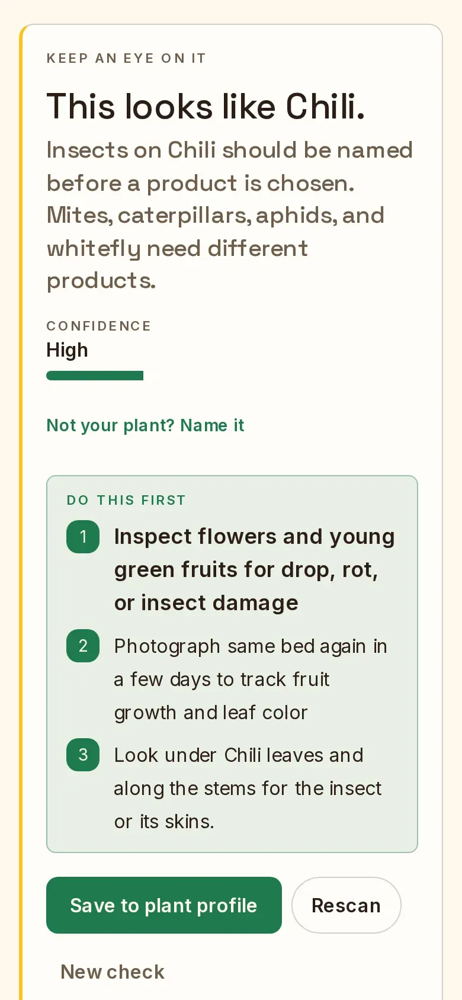
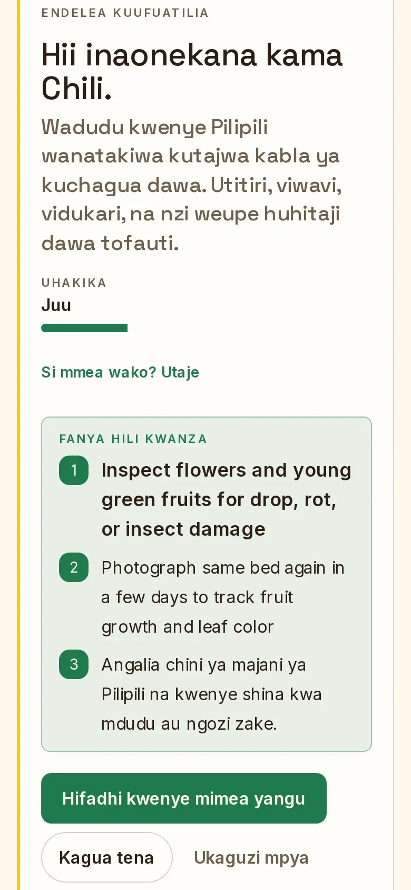
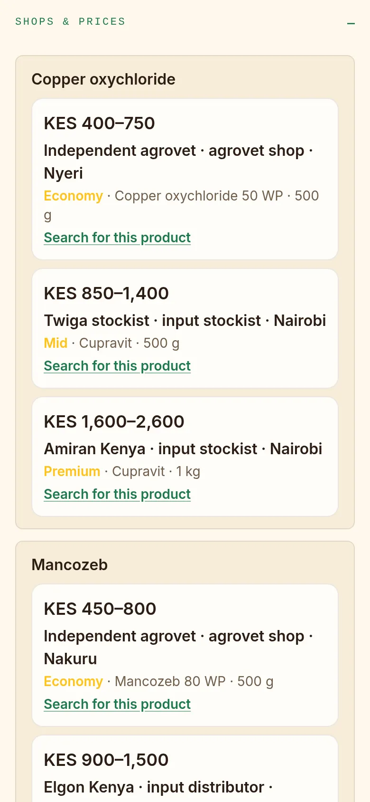
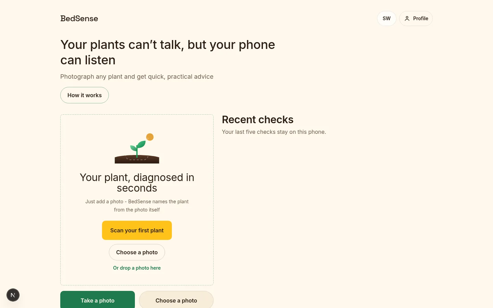

# BedSense

[](https://github.com/benweru/BedSense/actions/workflows/ci.yml)

Your plants can’t talk, but your phone can listen - photograph any plant and get quick, practical advice

**Live demo:** [https://bedsense.vercel.app](https://bedsense.vercel.app)

The live site runs in **demo mode** (sample results, no live Meta calls) now that the hackathon has ended. To run with live models, clone the repo and follow the live-mode steps in [docs/development.md](docs/development.md).

**Demo video:** [BedSense](https://drive.google.com/file/d/1JCkEP5gLpZGZd5rtJh-4MGWajfvqC-zI/view?usp=drive_link)

Just photograph the plant — BedSense names it from the photo. If it names the wrong plant, you can correct it on the result and re-check. You can also add one optional note: plant age or stage, current practices, chemicals already used, recent fertilizer, irrigation or weather, known issues, or anything else.

## Who it is for

Farmers on farm beds, and the extension officers who walk those beds with them.

Built for the **Cerebral Valley Meta Global AI Developer Hackathon**, **Indie** track, **Build for Your World**. The screen is in English or Kiswahili.

## What a photo becomes

The photo is read with the plant name you gave. When a symptom is visible, you get likely causes, practical mitigation, and three next checks for that plant. Example Kenyan agrovet shops and KES price bands appear when a spray is the usual next step, or when a fertilizer fits the symptom. When the photo does not separate the likely causes, no chemical is named: you get the safe steps that can start now and a plain statement of the angle or fact still needed. Every check ends with a follow-up question under the three next checks, and a box there lets you ask questions about the feedback without running a new check. Spray rates follow the product label. Confirm with a local agroveterinary officer before you buy or spray.

## Screens

<table>
  <tr>
    <td></td>
    <td></td>
    <td></td>
    <td></td>
  </tr>
  <tr>
    <td>Home</td>
    <td>A chili check with three next checks</td>
    <td>The same check in Kiswahili</td>
    <td>Example shops and KES price bands</td>
  </tr>
</table>



## Saved plants remember

Sign in and save a plant, and later checks are read against its history: earlier findings, what you sprayed or fed, and whether things improved. Each check also sets when to look again - the model judges how soon improvement or worsening would show, so a treated plant is re-checked after the spray has had time to work, and a healthy one only weekly.

## Run it on your machine

You need **Node.js 20.17 or newer** (22 recommended), **npm** (ships with Node), and **git**. No API keys are needed: with an empty environment file the app runs the full demo on synthetic data.

**macOS:** install Node and git with Homebrew (`brew install node git`), or the LTS installer from nodejs.org, or `nvm install 22`.

**Windows:** install Node.js LTS from nodejs.org (or `winget install OpenJS.NodeJS.LTS`) and Git for Windows (gives you Git Bash). Prefer a version manager? Use nvm-windows, then `nvm install 22`.

**Linux (Ubuntu/Debian):** `curl -fsSL https://deb.nodesource.com/setup_22.x | sudo -E bash -` then `sudo apt-get install -y nodejs git` (or use nvm). Fedora: `sudo dnf install -y nodejs git`, checking the version is ≥ 20.17.

Then, in a terminal (Git Bash or PowerShell on Windows):

```bash
git clone https://github.com/benweru/BedSense.git
cd BedSense
npm install
```

Copy the repo's example environment file to `.env.local`, start the dev server, and open http://localhost:3000 — on your phone or in a narrow browser window. The exact commands, the settings table, mock versus live mode, accounts, scripts, and troubleshooting are in [docs/development.md](docs/development.md).

## Team

- [Ben Maina](https://github.com/benweru) ([@benweru](https://github.com/benweru))
- [Ian Karanja](https://github.com/iankaranja13) ([@iankaranja13](https://github.com/iankaranja13))

## License

MIT. See [LICENSE](LICENSE).
