# Development

How to run and change BedSense on your own machine. The public product page is the [README](../README.md).

Node.js 20.17 or newer.

## Quick start

```bash
npm install
cp .env.example .env.local
npm run dev
```

Open [http://localhost:3000](http://localhost:3000) on your phone, or in a narrow browser window. Take a photo or choose one from the library. The app resizes it on the device, then `POST`s it to `/api/analyze`.

`.env.example` sets `MOCK_META=1` and leaves `MODEL_API_KEY` empty. That path returns synthetic masks and advice and does not call Meta. Use it for the demo, for judges without a key, and for `npm test`. If `MOCK_META` is unset and no key is available, BedSense stays in demo mode so a fresh clone still runs. Live calls happen only when `MOCK_META=0` and a server key is set.

## Environment

| Variable | Purpose |
| --- | --- |
| `MODEL_API_KEY` | Bearer token for `https://api.meta.ai/v1`. Read only on the server. Preferred locally. Leave empty in mock mode. A value of at least 40 characters is used as-is. |
| `MODEL_API_KEY_0` … `MODEL_API_KEY_5` | Optional Vercel workaround. If `MODEL_API_KEY` is empty or shorter than 40 characters, the server joins these six values in order. Leave them empty locally. |
| `MOCK_META` | `1` runs the demo with no model calls. `0` calls SAM 3.1, then Muse Spark. |

Copy `.env.example` to `.env.local`. Never commit a real key. `.gitignore` ignores `.env*`.

Live mode:

```bash
MODEL_API_KEY=your_key_here
MOCK_META=0
```

A full `MODEL_API_KEY` is the local default. If Vercel truncates that one variable, store the same key as `MODEL_API_KEY_0` through `MODEL_API_KEY_5`. BedSense joins those parts only when the single variable is missing or shorter than 40 characters.

Muse Spark is called as `muse-spark-1.3-contributor` first (contributor mode, lower price; prompts may be used to train future Meta models). If that call fails, BedSense retries `muse-spark-1.3` (standard mode). If both fail, the masks still return with a local backup of three next checks, and the screen says so. Those checks are practical things to look at or do on the bed. The backup does not invent a disease or a chemical. A numeric spray rate is still dropped.

## Pipeline

```mermaid
flowchart LR
  phone[Phone photo or camera] --> name[Farmer names the plant]
  name --> resize[Resize on device]
  resize --> context[Optional context]
  context --> api["POST /api/analyze"]
  api --> sam["SAM 3.1 · named plant plus concept prompts"]
  sam --> marks[Masks, boxes, counts]
  marks --> muse["Muse Spark · plant name, photo, counts"]
  muse --> guard[Dosage guard and chemical match]
  guard --> catalog[Kenya agrovet catalog]
  catalog --> ui[3 checks, chemicals, shops, KES bands]
```



1. The browser keeps the last five checks in `localStorage` and can switch the chrome between English and Kiswahili. Model text follows the language selected when you take the photo.
2. The farmer types the plant name before the check runs. It is required free text, not a crop list. `/api/analyze` rejects a photo that arrives without `plantName`.
3. `/api/analyze` accepts a JPEG, PNG, or WebP data URL. The key never goes to the client.
4. The segmentation model id is `sam-3.1`. It runs six concept prompts, one noun phrase each: `onion plant`, `beetroot plant`, `chili pepper plant`, `vegetable plant`, `yellow leaf`, `weed`. If the named plant is not already one of those phrases, BedSense adds one more prompt, such as `tomato plant`, on the generic plant concept. Requests use `metadata.mask_encoding=one_bit` and `metadata.include_confidence=true`. Masks are decoded with `@meta-sam/parser` and sent to the phone as a small grid drawn over the photo. A generic plant mask that sits on onion, beetroot, or chili is dropped so those crops keep their own outline.
5. A photo is one bed, and it can be any farm plant. Onion, beetroot, and chili each grow on their own bed. Onion and beetroot are never on the same bed, and chili is a separate bed as well. The code does not describe where those beds are. If more than one of those three is marked in a frame, crop focus is `mixed`: an unusual multi-crop frame, not the planting pattern. Onion area is weighted slightly higher, so when the scores are close the familiar primary mark stays onion. Muse prefers the name the farmer typed, and can still name a different plant when the photo clearly shows one.
6. Muse Spark sees the photo, the plant name, the counts, and any optional context. Observations describe only what stands out for plants actually in the photo: symptoms, vigor, spacing, damage, soil, or how many of those plants are in the frame. They do not name a crop that was not marked, and they do not say another crop is missing or secondary. Muse must return JSON: `detectedPlant`, observations, exactly three `actions`, a confidence score, `contextAsk`, `diseaseIndicated`, `suspect`, and `chemicals`. Optional context fields are plant age or stage, current practices, chemicals already used, recent weather or irrigation, known issues, and a free-text note. They are not required. `contextAsk` is one short question when a missing fact would improve the check, or empty. Each action is one next check: a practical thing to look at or do on the bed. The three checks stay free of spray rates. When a disease or pest looks likely, `chemicals` lists one or two actives with a product class and a typical-use note. The note must not invent millilitres, grams, or litres per tank. A server-side guard drops any spray rate (including common Swahili units) from observations, actions, and chemical notes. The disclaimer, the agroveterinary-officer line, and the “rate must follow the product label” line are fixed copy, not model prose.
7. Recommended actives are matched to `lib/agrovet-catalog.ts`, a curated list of fungicides and insecticides sold through Kenyan agrovets. Each match adds example shops (name, kind, city or chain) and KES price bands for economy, mid, and premium packs. Those bands are demo ranges, not a live quote. `liveKenyaShopOffers` in `lib/agrovet.ts` is the live-search stub: it returns `null`, and the catalog is used. No paid agrovet API is called, which keeps the lookup on Vercel Hobby. `MOCK_META=1` runs the same matcher, so the demo shows chemicals, shops, and KES bands without calling Meta.

## Scripts

```bash
npm test
npm run lint
npm run build
```

`npm start` serves a production build.
