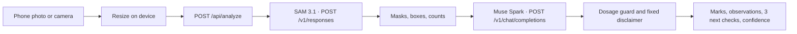

# Development

How to run and change BedSense on your own machine. The public product page is the [README](../README.md).

Node.js 20.17 or newer.

## Quick start

```bash
npm install
cp .env.example .env.local
npm run dev
```

Open [http://localhost:3000](http://localhost:3000) on your phone, or in a narrow browser window. Take a photo or choose one from the library. The app resizes it on the device, then `POST`s it to `/api/analyze`.

`.env.example` sets `MOCK_META=1` and leaves `MODEL_API_KEY` empty. That path returns synthetic masks and advice and does not call Meta. Use it for the demo, for judges without a key, and for `npm test`. If `MOCK_META` is unset and no key is available, BedSense stays in demo mode so a fresh clone still runs. Live calls happen only when `MOCK_META=0` and a server key is set.

## Environment

| Variable | Purpose |
| --- | --- |
| `MODEL_API_KEY` | Bearer token for `https://api.meta.ai/v1`. Read only on the server. Preferred locally. Leave empty in mock mode. A value of at least 40 characters is used as-is. |
| `MODEL_API_KEY_0` … `MODEL_API_KEY_5` | Optional Vercel workaround. If `MODEL_API_KEY` is empty or shorter than 40 characters, the server joins these six values in order. Leave them empty locally. |
| `MOCK_META` | `1` runs the demo with no model calls. `0` calls SAM 3.1, then Muse Spark. |

Copy `.env.example` to `.env.local`. Never commit a real key. `.gitignore` ignores `.env*`.

Live mode:

```bash
MODEL_API_KEY=your_key_here
MOCK_META=0
```

A full `MODEL_API_KEY` is the local default. If Vercel truncates that one variable, store the same key as `MODEL_API_KEY_0` through `MODEL_API_KEY_5`. BedSense joins those parts only when the single variable is missing or shorter than 40 characters.

Muse Spark is called as `muse-spark-1.3-contributor` first (contributor mode, lower price; prompts may be used to train future Meta models). If that call fails, BedSense retries `muse-spark-1.3` (standard mode). If both fail, the masks still return with a local backup of three non-chemical next checks, and the screen says so. Those checks are practical things to look at or do on the bed, not a diagnosis and not a treatment rate.

## Pipeline



1. The browser keeps the last five checks in `localStorage` and can switch the chrome between English and Kiswahili. Model text follows the language selected when you take the photo.
2. `/api/analyze` accepts a JPEG, PNG, or WebP data URL. The key never goes to the client.
3. The segmentation model id is `sam-3.1`. It runs five concept prompts, one noun phrase each: `onion plant`, `beetroot plant`, `chili pepper plant`, `yellow leaf`, `weed`. Requests use `metadata.mask_encoding=one_bit` and `metadata.include_confidence=true`. Masks are decoded with `@meta-sam/parser` and sent to the phone as a small grid drawn over the photo.
4. A photo is one bed. Onion is the primary crop. Beetroot and chili are secondary crops, each grown on its own bed. Onion and beetroot are never on the same bed, and chili is a separate bed as well. The code does not describe where those beds are. If more than one of those crops is marked in a frame, crop focus is `mixed`: an unusual multi-crop frame, not the planting pattern. Onion area is weighted slightly higher, so when the scores are close the primary crop stays onion. A frame that is only beetroot, or only chili, is labeled that crop. The copy still says onion is what BedSense is built around.
5. Muse Spark sees the photo plus the counts and must return JSON: observations, exactly three `actions`, and a confidence score. Each action is one next check shown in the app: a practical, non-chemical thing to look at or do on the bed. The three checks are triage steps for any vegetable farm bed. They are not a diagnosis and not a treatment rate. The developer prompt says onion stays first, beetroot and chili stay secondary, and each of those crops is on its own bed. A server-side guard drops any spray rate (millilitres, grams, litres per tank or hectare, including common Swahili units) and replaces it with a safe check. The disclaimer and the ask-an-agronomist callout are fixed copy, not model prose.

## Scripts

```bash
npm test
npm run lint
npm run build
```

`npm start` serves a production build.
