# Development

How to run and change BedSense on your own machine. The public product page is the [README](../README.md).

Node.js 20.17 or newer.

## Quick start

```bash
npm install
cp .env.example .env.local
npm run dev
```

Open [http://localhost:3000](http://localhost:3000) on your phone, or in a narrow browser window. Take a photo or choose one from the library. The app resizes it on the device, then `POST`s it to `/api/analyze`.

`.env.example` sets `MOCK_META=1` and leaves `MODEL_API_KEY` empty. That path returns synthetic masks and advice and does not call Meta. Use it for the demo, for judges without a key, and for `npm test`. If `MOCK_META` is unset and no key is available, BedSense stays in demo mode so a fresh clone still runs. Live calls happen only when `MOCK_META=0` and a server key is set.

## Environment

| Variable | Purpose |
| --- | --- |
| `MODEL_API_KEY` | Bearer token for `https://api.meta.ai/v1`. Read only on the server. Preferred locally. Leave empty in mock mode. A value of at least 40 characters is used as-is. |
| `MODEL_API_KEY_0` … `MODEL_API_KEY_5` | Optional Vercel workaround. If `MODEL_API_KEY` is empty or shorter than 40 characters, the server joins these six values in order. Leave them empty locally. |
| `MOCK_META` | `1` runs the demo with no model calls. `0` calls SAM 3.1, then Muse Spark. |

Copy `.env.example` to `.env.local`. Never commit a real key. `.gitignore` ignores `.env*`.

Live mode:

```bash
MODEL_API_KEY=your_key_here
MOCK_META=0
```

A full `MODEL_API_KEY` is the local default. If Vercel truncates that one variable, store the same key as `MODEL_API_KEY_0` through `MODEL_API_KEY_5`. BedSense joins those parts only when the single variable is missing or shorter than 40 characters.

Muse Spark is called as `muse-spark-1.3-contributor` first (contributor mode, lower price; prompts may be used to train future Meta models). If that call fails, BedSense retries `muse-spark-1.3` (standard mode). If both fail, the photo still returns. When the notes describe curling, spots, wilting, yellowing, insects, or deformed growth, the backup still gives hypotheses and three next checks for the named plant, plus Kenyan shop options when a product would help. Those checks are not a diagnosis and not a treatment rate.

## Pipeline

```mermaid
flowchart LR
  phone[Phone photo or camera] --> resize[Resize on device]
  resize --> name[Required plant name]
  name --> context[Optional context]
  context --> api["POST /api/analyze"]
  api --> sam["SAM 3.1 · POST /v1/responses"]
  sam --> marks[Masks, boxes, counts]
  marks --> muse["Muse Spark · POST /v1/chat/completions"]
  muse --> guard[Dosage guard and fixed disclaimer]
  guard --> ui[Plant name, marks, causes, 3 next checks, shops]
```



1. The browser keeps the last five checks in `localStorage` and can switch the chrome between English and Kiswahili. Model text follows the language selected when you take the photo.
2. `/api/analyze` accepts a JPEG, PNG, or WebP data URL. The key never goes to the client.
3. The segmentation model id is `sam-3.1`. It prompts for the named plant, plus `yellow leaf` and `weed`. It does not prompt for onion, beetroot, or chili unless that is the plant the farmer named. Requests use `metadata.mask_encoding=one_bit` and `metadata.include_confidence=true`. Masks are decoded with `@meta-sam/parser` and sent to the phone as a small grid drawn over the photo. A generic plant mask that sits on onion, beetroot, or chili is dropped so those crops keep their own outline. If every prompt fails or returns nothing, the check continues. Empty marks are not shown as missing crops from another bed.
4. The app requires a plant name before the photo. It is a free-text field, not a menu. A photo can be a bed, a close-up, or fruit in the hand, and it can be any farm plant. Onion, beetroot, and chili are familiar crops: BedSense works well with onion and is often used for beetroot and chili. Each grows on its own bed. Onion and beetroot are never on the same bed, and chili is a separate bed as well. The code does not describe where those beds are. If more than one of those three is marked in a frame, crop focus is `mixed`: an unusual multi-crop frame, not the planting pattern. Onion area is weighted slightly higher, so when the scores are close the familiar primary mark stays onion. Spelling variants fold to one display name (`chilly`, `chilli`, and `chili` all show as Chili in English).
5. Muse Spark sees the photo, the plant name, the counts, and any optional context, and must return JSON: `detectedPlant`, observations, hypotheses, exactly three `actions`, a confidence score, `contextAsk`, `chemicalsHelp`, and `issue`. Optional context fields are plant age or stage, current practices, chemicals already used, recent weather or irrigation, known issues, and a free-text note. They are not required. `contextAsk` is one short question when a missing fact would improve the check, or empty. Empty SAM marks do not skip hypotheses. Each action is one next check shown in the app. The three checks are not a diagnosis and not a treatment rate. A server-side guard drops any spray rate (millilitres, grams, litres per tank or hectare, including common Swahili units) and replaces it with a safe check. Stands-out text that names a crop the farmer did not name, and that was not marked, is dropped. When `chemicalsHelp` is true for curling, deformed growth, spots, or insects, BedSense adds a fixed Kenyan agrovet catalog with indicative KES bands. The model does not invent shops or prices. The disclaimer and the ask-an-agronomist callout are fixed copy, not model prose.

## Scripts

```bash
npm test
npm run lint
npm run build
```

`npm start` serves a production build.
