# Development

How to run and change BedSense on your own machine. The public product page is the [README](../README.md).

Node.js 20.17 or newer.

## Quick start

```bash
npm install
cp .env.example .env.local
npm run dev
```

Open [http://localhost:3000](http://localhost:3000) on your phone, or in a narrow browser window. Take a photo or choose one from the library. The app resizes it on the device, then `POST`s it to `/api/analyze`.

`.env.example` sets `MOCK_META=1` and leaves `MODEL_API_KEY` empty. That path returns synthetic masks and advice and does not call Meta. Use it for the demo, for judges without a key, and for `npm test`. If `MOCK_META` is unset and no key is available, BedSense stays in demo mode so a fresh clone still runs. Live calls happen only when `MOCK_META=0` and a server key is set.

## Environment

| Variable | Purpose |
| --- | --- |
| `MODEL_API_KEY` | Bearer token for `https://api.meta.ai/v1`. Read only on the server. Preferred locally. Leave empty in mock mode. A value of at least 40 characters is used as-is. |
| `MODEL_API_KEY_0` … `MODEL_API_KEY_5` | Optional Vercel workaround. If `MODEL_API_KEY` is empty or shorter than 40 characters, the server joins these six values in order. Leave them empty locally. |
| `MOCK_META` | `1` runs the demo with no model calls. `0` calls SAM 3.1, then Muse Spark. |

Copy `.env.example` to `.env.local`. Never commit a real key. `.gitignore` ignores `.env*`.

Live mode:

```bash
MODEL_API_KEY=your_key_here
MOCK_META=0
```

A full `MODEL_API_KEY` is the local default. If Vercel truncates that one variable, store the same key as `MODEL_API_KEY_0` through `MODEL_API_KEY_5`. BedSense joins those parts only when the single variable is missing or shorter than 40 characters.

BedSense reads `GET /v1/models` and calls only a Muse Spark or Muse Wonder chat model from that list. `muse-spark-1.3-contributor` is preferred when the catalog lists it (contributor mode, lower price; prompts may be used to train future Meta models), then `muse-spark-1.3`. Image, voice, and SAM ids are not used for triage. Ids that the catalog does not list are not guessed. If the catalog has no Muse chat model, or every listed chat model returns model_not_found, the check stops with `muse_unavailable` instead of the generic soil, leaf, and re-photo checks. Enable a Muse Spark or Muse Wonder chat model for this key in the Meta Model API dashboard, then run the check again. A fast rate limit or 5xx is tried once on that same model, then the other model runs. A timeout moves straight to the other model. Streamed replies are read from both LF and CRLF frames, including when the response is labeled JSON. The completion budget leaves room for reasoning tokens so the triage JSON is not cut off. SAM waits at most 20 seconds, so a slow mask pass still reaches Muse inside the 60 second Hobby limit. If a listed model fails for another reason, the photo returns with a local backup of three next checks, and the screen says so. Those checks are practical things to look at or do on the bed. When the farmer’s notes describe a symptom such as curl, spots, wilt, or insects, the backup follows that symptom for any named plant, including catalog chemicals when a spray is the usual next step. Otherwise it does not invent a disease or a chemical. A numeric spray rate is still dropped. Empty SAM marks are not a reason to skip the check.

Optional context can be typed or held as a voice note beside those fields. The phone records push-to-talk audio, converts it to mono 16-bit PCM WAV at 16 kHz, and `POST /api/transcribe` uploads it to `muse-voice-transcribe-1.0` with `audioEncoding: "WAV"` and `mode: "PUSH_TO_TALK"`. The JSON `transcript` is appended to the context field the farmer picked (stage, practices, chemicals, weather, issues, or notes). That same field is what Muse already reads. English sends `languageBias: ["English"]`. Kiswahili sends `["Swahili", "English"]`. Meta's published voice list does not include Swahili, so a 400 on that bias is retried with English only, and the farmer can edit the text. A realtime WebSocket is not used. `MOCK_META=1` returns a short sample sentence and does not call Meta.

## Pipeline

```mermaid
flowchart LR
  phone[Phone photo or camera] --> name[Farmer names the plant]
  name --> resize[Resize on device]
  resize --> context[Optional context]
  context --> api["POST /api/analyze"]
  api --> sam["SAM 3.1 · named plant, yellow leaf, weed"]
  sam --> marks[Masks, boxes, counts]
  marks --> muse["Muse Spark · plant name, photo, counts"]
  muse --> guard[Dosage guard, causes, mitigation]
  guard --> catalog[Kenya agrovet catalog when a spray is usual]
  catalog --> ui[Causes, mitigation, 3 checks, shops]
```



1. The browser keeps the last five checks in `localStorage` and can switch the chrome between English and Kiswahili. Model text follows the language selected when you take the photo.
2. The farmer types the plant name before the check runs. It is required free text, not a crop list. `/api/analyze` rejects a photo that arrives without `plantName`.
3. `/api/analyze` accepts a JPEG, PNG, or WebP data URL. The key never goes to the client.
4. The segmentation model id is `sam-3.1`. It prompts only the plant the farmer named, plus `yellow leaf` and `weed`. A known crop uses its concept phrase, such as `chili pepper plant` or `onion plant`. Any other name uses a phrase such as `tomato plant`. It does not probe onion, beetroot, and chili on every photo, so a miss on another bed cannot become a note. If every prompt fails or returns nothing, BedSense still sends the photo to Muse. Requests use `metadata.mask_encoding=one_bit` and `metadata.include_confidence=true`. Masks are decoded with `@meta-sam/parser` and sent to the phone as a small grid drawn over the photo. A generic plant mask that sits on onion, beetroot, or chili is dropped so those crops keep their own outline.
5. A photo is one bed, and it can be any farm plant. Onion, beetroot, and chili each grow on their own bed. Onion and beetroot are never on the same bed, and chili is a separate bed as well. The code does not describe where those beds are. If more than one of those three is marked in a frame, crop focus is `mixed`: an unusual multi-crop frame, not the planting pattern. Onion area is weighted slightly higher, so when the scores are close the familiar primary mark stays onion. Muse prefers the name the farmer typed, and can still name a different plant when the photo clearly shows one.
6. Muse Spark sees the photo, the plant name, the counts, and any optional context. Observations describe only what stands out for plants actually in the photo. They do not name a crop that was not marked. A failed segmentation prompt is not shown. Empty marks do not skip the reading: if the photo or the notes show a symptom (curl, deformity, spots, insects, wilt, yellowing), the result includes likely causes, mitigation steps, and three checks about that symptom. The generic soil / remove-leaves / photograph-again backup is only for a reading with no symptom. A known spelling variant, such as chilly for chili, is folded to the canonical name in English or Kiswahili in the cards, not only in the title. Muse returns JSON with `detectedPlant`, `symptom`, observations, `likelyCauses`, `mitigations`, exactly three `actions`, `contextAsk`, `sprayIndicated`, `diseaseIndicated`, `suspect`, and `chemicals`. A cut-off or prose reply that still describes the symptom is kept. Chemicals and Kenyan shop bands are added only when a spray is the usual next step (spots, insects already seen, or curl/deformity where the reading also shows insects). Curl alone stays on cultural steps. The note must not invent a numeric spray rate. The phone shows a progress card while SAM and Muse run.
7. Recommended actives are matched to `lib/agrovet-catalog.ts`, a curated list of fungicides and insecticides sold through Kenyan agrovets. Each match adds example shops (name, kind, city or chain) and KES price bands for economy, mid, and premium packs. Those bands are demo ranges, not a live quote. `liveKenyaShopOffers` in `lib/agrovet.ts` is the live-search stub: it returns `null`, and the catalog is used. No paid agrovet API is called, which keeps the lookup on Vercel Hobby. `MOCK_META=1` runs the same matcher, so the demo shows chemicals, shops, and KES bands without calling Meta.

## Scripts

```bash
npm test
npm run lint
npm run build
```

`npm start` serves a production build.
